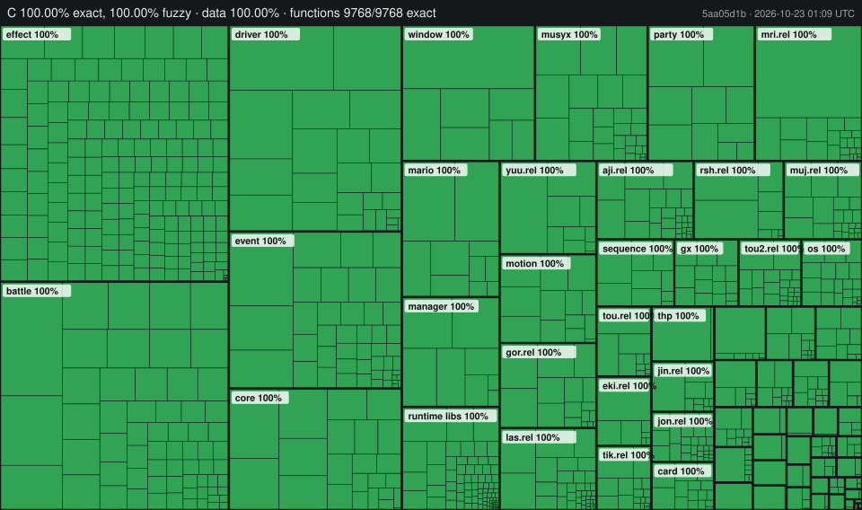

Paper Mario: The Thousand-Year Door
[![Build Status]](https://github.com/LLCOOLT/ttyd/actions/workflows/build.yml) ![Progress] ![Functions Progress] ![Data Progress] ![Linked Progress]
=============

[Build Status]: https://github.com/LLCOOLT/ttyd/actions/workflows/build.yml/badge.svg?branch=main
[Progress]: https://img.shields.io/badge/Code-100.00%25-blue
[Functions Progress]: https://img.shields.io/badge/Functions-100.00%25-blue
[Data Progress]: https://img.shields.io/badge/Data-100.00%25-blue
[Linked Progress]: https://img.shields.io/badge/Linked-100.00%25-blue

A matching decompilation of Paper Mario: The Thousand-Year Door for the GameCube. One C source tree builds four versions of the game, and each build reproduces its original files byte for byte: the main executable and every area module (REL).

This repository does **not** contain any game assets or disassembled game code. You need your own copy of the game to build it.

## Status

| Version | Release | Units linked from C | Build check |
|---|---|---|---|
| `G8MJ01` | Japan (the default) | 1234 / 1234 | `32 files OK` |
| `G8ME01` | North America | 1226 / 1226 | `30 files OK` |
| `G8MP01` | Europe (English, German, French, Spanish, Italian), with the developer test REL `tst.rel` | 1378 / 1378 | `33 files OK` |
| `G8ME01_DEMO` | June 2004 demo from the Interactive Multi-Game Demo Disc Version 17 (USA) | 746 / 746 | `7 files OK` |

All four builds are byte-identical to the originals, and every unit of every version is compiled from C. All source is C; the only assembly is what the original sources had in assembly (a few SDK, runtime and debugger routines, the hardware helpers in `include/hwaccess.h` and the word copy `memcpy_as4` in `src/system.c`).

Some functions use small behaviour-identical tricks to reach a byte-identical build. Each is marked in the code with a `FAKE` comment and listed in [docs/FAKES.md](docs/FAKES.md).



Live progress maps (interactive versions of the treemap above): [JP (G8MJ01)](https://claude.ai/artifact/74tZKbcCQ7WUWFM577oqmY), [US (G8ME01)](https://claude.ai/artifact/1Hdacn3R1wrwjtwDQRuwKJ), [PAL (G8MP01)](https://claude.ai/artifact/ASn2MeDwtzWvpJa2MidDyv) and [Demo (G8ME01_DEMO)](https://claude.ai/artifact/6ZkmJBXFMxFc4m8i5M5YhA)

## Quick build

You need Python 3 and [ninja](https://github.com/ninja-build/ninja/releases) (`pip install ninja` works). On macOS, and on Linux outside x86, you also need Wine; see [docs/BUILDING.md](docs/BUILDING.md#dependencies).

```sh
git clone https://github.com/LLCOOLT/ttyd.git
cd ttyd
# copy your Japanese disc image into orig/G8MJ01/
python configure.py
ninja
```

A matching build ends with `32 files OK`. For another version, run `python configure.py --version G8ME01` (or `G8MP01`, `G8ME01_DEMO`) with that disc in `orig/<version>/`. [docs/BUILDING.md](docs/BUILDING.md) has the details: which file goes where for each version (including the demo's `zz_PaperMario2_game.tgc`), building all four, running a build in Dolphin, objdiff and troubleshooting.

## Documentation

| Document | What it covers |
|---|---|
| [docs/BUILDING.md](docs/BUILDING.md) | Dependencies, disc files per version, building and checking all four versions, running a build, objdiff, troubleshooting |
| [docs/VERSIONS.md](docs/VERSIONS.md) | What differs between JP, US, PAL and the demo, and how the sources express it (`VERSION_*` macros, `VERSION_PICK`, `FPS_FRAMES`, small-data thresholds, REL sets) |
| [docs/ARCHITECTURE.md](docs/ARCHITECTURE.md) | How the game is put together: boot, frame loop, sequences, the event script system, maps and RELs, drivers, battle, memory, sound, and where each lives |
| [docs/CONTRIBUTING.md](docs/CONTRIBUTING.md) | Code standards, the four-version check, fakes, adding a version difference, commit style |
| [docs/GLOSSARY.md](docs/GLOSSARY.md) | Romanised Japanese names used in the code, every REL area code, common abbreviations |
| [docs/KNOWN_GAME_BUGS.md](docs/KNOWN_GAME_BUGS.md) | Bugs of the original game that the code reproduces, with file and line |
| [docs/FAKES.md](docs/FAKES.md) | Every behaviour-identical matching trick, per function |
| [docs/NAME_PROVENANCE.md](docs/NAME_PROVENANCE.md) | Names that were invented here rather than taken from a symbol map |
| [docs/PROGRESS.md](docs/PROGRESS.md) | Progress history and the code-quality cleanup figures |
| [docs/THIRD_PARTY.md](docs/THIRD_PARTY.md) | Third-party code in `libs/` and `rels/tst/`, origins and licences, and the build-time tools |
| [tools/README.md](tools/README.md) | The scripts in `tools/` and the `configure.py` options |

## Project layout

- `src/`: the main executable (`MarioSt.dol`), by system: `battle/`, `driver/`, `effect/`, `event/`, `manager/`, `mario/`, `motion/`, `party/`, `sequence/`, `unit/`, `window/`, `data/`, and core files such as `src/main.c`, `src/system.c` and `src/memory.c`.
- `rels/<area>/`: one folder per area REL, each with its own `src/` and `include/`. Battle units and area data live under the area that loads them.
- `include/`: headers for the main executable, mirroring `src/`.
- `libs/`: the libraries linked into the game: the Dolphin SDK, MSL, MusyX, the Metrowerks runtime and TRK.
- `config/<version>/`: decomp-toolkit configuration per version (`config.yml`, `splits.txt`, `symbols.txt`, `build.sha1`).
- `docs/`, `tools/`: documentation and scripts.

## Origins and credit

This project started as a fork of [doldecomp/ttyd](https://github.com/doldecomp/ttyd), which grew out of [NWPlayer123](https://github.com/NWPlayer123)'s original G8MJ01 decomp-toolkit setup. The project structure, build system, splits, symbols and the early decompilation work come from them and their contributors. Many thanks to everyone who worked on it. The US version also draws on [Silver136](https://github.com/Silver-136/ttyd_dtk_Silver136)'s US decompilation. The project stays under the MIT licence: [LICENSE](LICENSE) keeps the original copyright notice and adds one for the work since the fork. Third-party code keeps its own licence; see [docs/THIRD_PARTY.md](docs/THIRD_PARTY.md).

It is now an **independent project and is not affiliated with doldecomp**. All of the code added since the fork was written with the help of AI tools (Anthropic's Claude), so it is kept separate from the upstream project. Please don't take questions about this repository to the doldecomp community; use this repository's issues instead.

## Detailed progress

Generated by `tools/update_readme.py` from each version's `build/<version>/report.json`.

<!-- progress-start -->
**Progress** (all source is C; units whose C does not match yet are built from the original code, so the build stays byte-identical):

| Measure | Value |
|---|---|
| **Code matched by C** (by code size) | **100.00%** |
| **Functions matched by C** | **9768 / 9768** (100.0%) |
| Files linked from C | 1234 / 1234 (100.00% of code) |
| Fuzzy match | 100.00% |
| Data, exact (bytes + where each relocation points; objdiff's name-paired figure is 100.00%) | 100.00% |

Per category, JP (G8MJ01) (generated by `tools/update_readme.py`):

| Category | Matched code | Linked code | Linked files | Matched functions |
|---|---|---|---|---|
| All | 100.00% | 100.00% | 1234 / 1234 | 9768 / 9768 |
| DOL | 100.00% | 100.00% | 634 / 634 | 6990 / 6990 |
| Modules | 100.00% | 100.00% | 600 / 600 | 2778 / 2778 |
| Game Code | 100.00% | 100.00% | 1022 / 1022 | 8275 / 8275 |
| SDK Code | 100.00% | 100.00% | 181 / 181 | 1126 / 1126 |
| MusyX Code | 100.00% | 100.00% | 31 / 31 | 367 / 367 |

**US (G8ME01)**, data matched 100.00%:

| Category | Matched code | Linked code | Linked files | Matched functions |
|---|---|---|---|---|
| All | 100.00% | 100.00% | 1226 / 1226 | 9748 / 9748 |
| DOL | 100.00% | 100.00% | 630 / 630 | 6968 / 6968 |
| Modules | 100.00% | 100.00% | 596 / 596 | 2780 / 2780 |
| Game Code | 100.00% | 100.00% | 1016 / 1016 | 8283 / 8283 |
| SDK Code | 100.00% | 100.00% | 179 / 179 | 1098 / 1098 |
| MusyX Code | 100.00% | 100.00% | 31 / 31 | 367 / 367 |

**Europe (G8MP01)**, data matched 100.00%:

| Category | Matched code | Linked code | Linked files | Matched functions |
|---|---|---|---|---|
| All | 100.00% | 100.00% | 1378 / 1378 | 10271 / 10271 |
| DOL | 100.00% | 100.00% | 635 / 635 | 7041 / 7041 |
| Modules | 100.00% | 100.00% | 743 / 743 | 3230 / 3230 |
| Game Code | 100.00% | 100.00% | 1165 / 1165 | 8774 / 8774 |
| SDK Code | 100.00% | 100.00% | 182 / 182 | 1130 / 1130 |
| MusyX Code | 100.00% | 100.00% | 31 / 31 | 367 / 367 |

**Demo (G8ME01_DEMO)**, data matched 90.54%:

| Category | Matched code | Linked code | Linked files | Matched functions |
|---|---|---|---|---|
| All | 100.00% | 100.00% | 746 / 746 | 7478 / 7478 |
| DOL | 100.00% | 100.00% | 633 / 633 | 6908 / 6908 |
| Modules | 100.00% | 100.00% | 113 / 113 | 570 / 570 |
| Game Code | 100.00% | 100.00% | 533 / 533 | 5981 / 5981 |
| SDK Code | 100.00% | 100.00% | 182 / 182 | 1130 / 1130 |
| MusyX Code | 100.00% | 100.00% | 31 / 31 | 367 / 367 |

objdiff compares data symbol by symbol, and data it cannot pair with a symbol of the version's config counts as unmatched, so this figure can stay below 100% while the build check above confirms that every file is byte-identical.
<!-- progress-end -->
